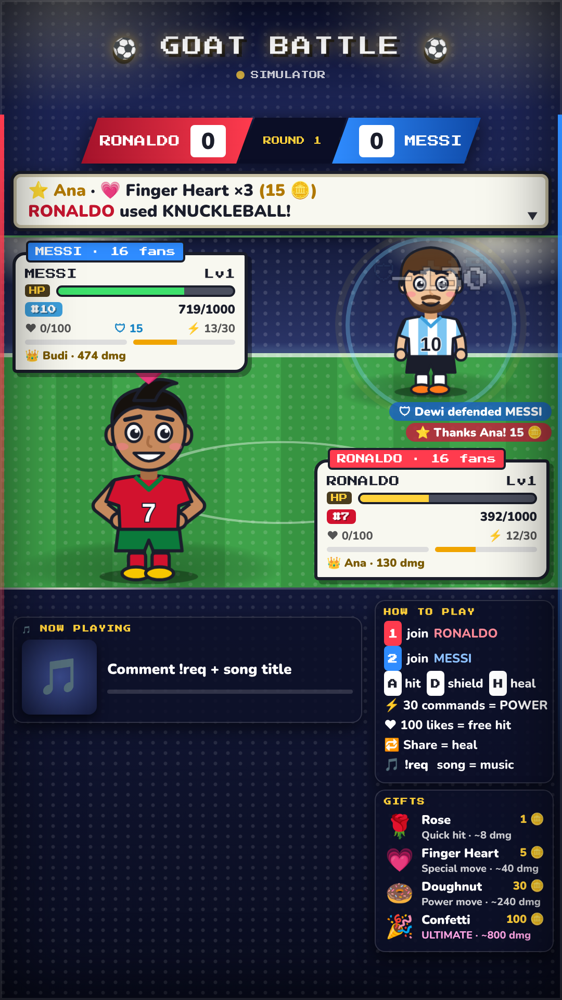

# ⚽ GOAT Battle Live

**An interactive TikTok LIVE game.** Viewers pick a side in the comments (RONALDO or MESSI), then attack, defend and heal by commenting. Gifts trigger bigger moves, and viewers can request songs with `!req`.

<p align="center">
  
</p>

## Download

| Windows | Mac (Apple M1–M4) | Mac (Intel) |
|:---:|:---:|:---:|
| [**MonsterBattleLive-portable.exe**](https://github.com/HyperNoobzz/monster-battle-live/releases/latest/download/MonsterBattleLive-portable.exe) | [**MonsterBattleLive-mac-arm64.zip**](https://github.com/HyperNoobzz/monster-battle-live/releases/latest/download/MonsterBattleLive-mac-arm64.zip) | [**MonsterBattleLive-mac-x64.zip**](https://github.com/HyperNoobzz/monster-battle-live/releases/latest/download/MonsterBattleLive-mac-x64.zip) |

These links always point to the newest version. All versions are on the [Releases page](https://github.com/HyperNoobzz/monster-battle-live/releases).

---

## 🇮🇩 Cara cepat

1. **Unduh** aplikasi di atas.
   - Windows: klik dua kali file `.exe`. Kalau muncul "Windows protected your PC", klik **More info**, lalu **Run anyway**.
   - Mac: klik dua kali file `.zip`, lalu seret **Monster Battle Live** ke **Applications**. Saat pertama dibuka, buka **System Settings → Privacy & Security** dan klik **Open Anyway**.
2. **Mulai LIVE** di TikTok LIVE Studio.
3. Di game, tekan **S** (atau ⚙), ketik **username TikTok** kamu, lalu klik **Go live**. Pojok atas berubah jadi `LIVE @username`.
4. Tekan **S** lagi untuk menutup panel. Di LIVE Studio, tambahkan **Window Capture** dan pilih jendela **Monster Battle Live**.
5. Pastikan **audio komputer** ikut masuk ke live supaya lagu dari `!req` terdengar oleh penonton.

**Perintah untuk penonton:** `1` atau `2` untuk join tim · `A` serang · `D` perisai · `H` pulihkan HP · `!req judul lagu` untuk request lagu.

---

## How viewers play

| Comment | Effect |
|---|---|
| `1` · `ronaldo` · `cr7` · `red` · `merah` | Join team **RONALDO** |
| `2` · `messi` · `lm10` · `blue` · `biru` | Join team **MESSI** |
| `A` · `attack` · `serang` | Kick the ball at the other player (~1.2% of their max HP per comment) |
| `D` · `defend` · `tahan` | Add a shield 🛡 to your player (1.5% of max HP each, up to 30%) |
| `H` · `heal` · `sembuh` | Restore 0.8% of your player's max HP |
| `!req <song title>` | Request a song (also `!lagu`, `!song`, `!request`) |

- Viewers who attack, like or gift without joining are placed on the smaller team. Commenting `1` or `2` again switches teams.
- Each viewer can use a command once every 2 seconds (adjustable). Comments that arrive together become one team volley.
- Comment attacks land immediately, about 0.25 s after the comment reaches the game, even while gift animations are playing.
- Every **30** commands from a team charge a **⚡ POWER move** (8% of the enemy's max HP).
- Every **100 likes** per team = a free attack. A **follow** = a free attack. A **share** heals 4% (once per viewer per 30 s).
- Critical hits deal ×2. A knockout wins the round, crowns the team's top damage dealer as **👑 MVP**, and both players come back stronger next round.

### Gifts

A gift makes the sender's player attack right away. Bigger gifts trigger bigger moves:

| Gift value | Move | Example |
|---|---|---|
| 1–4 coins | Quick hit | Rose |
| 5–29 coins | Special move | Finger Heart |
| 30–99 coins | Power move (screen shake) | Doughnut |
| 100+ coins | ULTIMATE (flash + shake) | Confetti |

Damage is coins × *Support damage per coin* (default 8). The sender's name shows in gold with the gift's picture, count and total coins, and their damage counts toward MVP. Gift combos (for example Rose ×5) are counted once, when the combo ends.

The **Gifts** card shows each gift's picture, coins, effect and approximate damage. The pictures are TikTok's own gift images: each one is learned the first time someone sends that gift, and remembered on that computer. Until then an emoji stands in (🌹 💗 🍩 🎉). Turn the card off with **Show gift guide on screen** in ⚙.

### Song requests (`!req`)

The game searches YouTube for the title and plays **the audio only**. The **Now playing** card shows the cover, title, who requested it, a progress bar and the next songs.

- One request per viewer every 30 s, at most 2 waiting per viewer, 15 in the queue.
- Videos shorter than 30 s or longer than 10 min are skipped. If a video can't be played outside YouTube, the next search result is tried.
- ⚙ panel: **Skip song**, **Pause / play**, **Clear queue**, **Music volume**, **Allow !req song requests**.
- The YouTube player runs hidden in the background. YouTube's terms ask for its player to be visible, so YouTube could stop playback in this mode at some point.

---

## Going live

### Built-in TikTok connection
Type your TikTok username in ⚙ and press **Go live**. The game connects to the LIVE of that account, whichever device the LIVE runs on. Viewers only see the game if the game window is what you broadcast (for example a Window Capture in TikTok LIVE Studio).

- `WAITING FOR LIVE`: the account isn't live yet. The game checks every 10 seconds and connects by itself.
- Each attempt is limited to 25 seconds; the status line shows the attempt number and any error.

### Using TikFinity instead
If you run **TikFinity Desktop** on the same computer, open ⚙ and press **Use TikFinity**. The game reads TikFinity's local event feed (`ws://localhost:21213/`). The header shows `LIVE · TIKFINITY` once the first comment, like or gift arrives. Press **Stop using TikFinity** to switch back.

### Mac: "damaged" message
If macOS says the app "is damaged" (copies downloaded before v1.1.4), run this once in Terminal, then open the app again:
```
xattr -cr "/Applications/Monster Battle Live.app"
```

### App window
The **Window** menu has *Always on top*, *Full screen* (F11) and sizes up to 1080×1920. Press **S** to show or hide the ⚙ panel; it is never part of the game picture once closed.

---

## Settings (⚙ panel)

| Setting | Default | What it does |
|---|---|---|
| RED / BLUE player name | RONALDO / MESSI | Names shown everywhere on screen |
| Base HP | 1000 | Player HP in round 1 (grows ×1.3 per round). Lower it for small audiences so rounds finish faster |
| Support damage per coin | 8 | Gift damage per coin |
| Likes per free attack | 100 | |
| Commands per POWER move | 30 | |
| Comment cooldown (sec) | 2 | How often one viewer can use A / D / H |
| Show gift guide on screen | on | The Gifts card |
| Show TikTok screen zones | off | Setup helper: marks where TikTok's own UI covers the stream on phones |
| Allow !req song requests | on | |
| Music volume | 60 | |
| Sound effects | on | |

The panel also has simulator buttons (fake viewers, comments, gifts, likes, song requests) to try everything without going live.

## Screen layout

The 9:16 screen is laid out around TikTok's phone view, where TikTok draws its own UI over the stream:
- **Top:** logo and connection status only (TikTok shows the host name and viewer count there).
- **Middle:** scoreboard, battle message, the pitch with both players and their HP boxes.
- **Bottom-right:** *How to play* and *Gifts* cards (TikTok leaves this area free).
- **Bottom-left:** *Now playing* music card; TikTok's comments appear over this area.

---

## Web version and bridge

`index.html` also runs in a browser.
1. **Simulator only:** open `index.html`, press **S** and use the buttons.
2. **With TikTok LIVE** (Node.js 18+):
   ```
   cd bridge
   npm install
   node bridge.js YOUR_TIKTOK_USERNAME
   ```
   Then open `http://localhost:8080/`. The bridge serves the game and relays comments, gifts, likes, shares and song searches. Song requests need this `http://localhost:8080/` address.
3. In OBS or TikTok LIVE Studio, add a Browser Source with `http://localhost:8080/?clean` at 1080×1920 (`?clean` hides the ⚙ button).

## Development

```
npm install
npm start            # run the desktop app
npm run dist:win     # Windows .exe in dist/
npm run dist:mac     # macOS .app in dist/ (on a Mac)
```

| Path | What it is |
|---|---|
| `index.html` | The whole game: layout, characters (drawn in code), battle logic, gift guide, song player, simulator |
| `bridge/bridge.js` | Local server: serves the game over HTTP, connects to TikTok LIVE, searches YouTube |
| `desktop/` | Electron app (window, menu, preload) |
| `.github/workflows/build-apps.yml` | Builds the Windows and Mac apps and publishes a release on every push to `main` |

## Notes

- **Characters:** original chibi drawings made in code, with no photos, club crests or brand logos. The names refer to real people. If TikTok ever flags that, change them in ⚙.
- **Music copyright:** commercial songs played on a TikTok LIVE can get the LIVE muted or flagged. Turn song requests off in ⚙ if that happens.
- **TikTok connection:** uses the unofficial [TikTok-Live-Connector](https://github.com/zerodytrash/TikTok-Live-Connector) library, which signs requests through the Euler Stream service. TikTok can change things that break it; TikFinity is the fallback.
